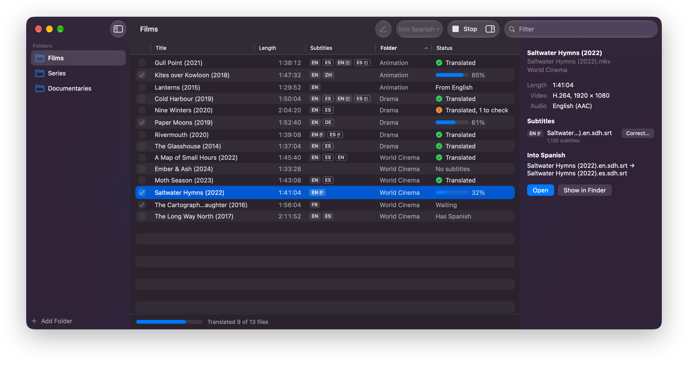

<!-- Generated from Distribution/release-repo/README.md in the SubStantial repository on each release; edit it there. -->
<h1 align="center">SubStantial</h1>

<p align="center">
  Translate whole folders of subtitles with a language model, on the Mac.
</p>

<p align="center">
  
</p>

SubStantial finds the subtitles in your video folders, next to your videos and inside them, and gives each video the
ones it's missing in your language: downloaded from subtitle sites where people have made them, and otherwise
translated with the language model you choose. Each file is saved next to its video, named so media players find it:
`Movie.en.srt` gets a `Movie.es.srt`. Videos with no subtitles at all can have them written down from their speech,
with Whisper on your Mac. Use the Mac app to translate, watch, check and fix them, or `substantial` on the command
line for scripts and servers.

## Download

| | Homebrew | Or download from [Releases](../../releases/latest) |
|---|---|---|
| **SubStantial**, the Mac app | `brew install galaco/tap/substantial` | `SubStantial-<version>.dmg`: open it and drag SubStantial to Applications |
| **substantial**, the command-line tool | `brew install galaco/tap/substantial-cli` | `substantial-<version>-macos.zip`: unzip it and put `substantial` on your `PATH` |

Both are free, run on macOS 14 or later on Apple silicon and Intel Macs, and are signed and notarized by Apple.
`brew upgrade` keeps Homebrew installs up to date; downloads from Releases don't update themselves. Homebrew
also installs the command-line tool's man page (`man substantial`) and completions for zsh, bash and fish.

To translate, you need a language model: an API key for OpenRouter, OpenAI or another OpenAI-compatible service,
Ollama or LM Studio running on your Mac, or, in the app, a model SubStantial downloads and runs itself.

## The app

- **Whole libraries:** every video's subtitles are found, whether they're next to it, in a `Subs` folder or inside
  it, and each video gets the ones it's missing, full and forced. A library of thousands of episodes stays
  responsive, with its shows and seasons in the sidebar.
- **Subtitles people made, first:** before translating, SubStantial looks on [OpenSubtitles.com](https://www.opensubtitles.com),
  SubDL and SubSource, prefers subtitles made for your very release, and lines the others up with the speech.
- **Any model:** OpenRouter, OpenAI, Ollama, LM Studio, any OpenAI-compatible service, or Gemma 4, which SubStantial
  downloads and runs on your Mac.
- **Translations that hold together:** the model reads each file through first, is told what it's watching (from
  the `.nfo` files Jellyfin, Kodi and Emby keep), and follows a show's glossary, so names stay the same in every
  episode. Only the words are sent, so times can't change, and a translation stopped part of the way carries on
  from there.
- **Subtitles from speech:** Whisper writes down what's said in videos without subtitles, on your Mac, and your
  model can translate it.
- **Watch, check and fix:** each video opens in its own window, with the subtitles over the picture, the original
  alongside, and a timeline of the sound to edit and retime them. ASS subtitles look as they do in mpv and VLC.
  Subtitles that are early or late are synced to the speech in one step, and those too fast or too long to read are
  marked and fixed. Your model can also proofread them, and you review every change.
- **Every common format:** SubRip, WebVTT, SubStation Alpha, TTML, SAMI, SubViewer, LRC and MicroDVD, in any
  common encoding, with their formatting kept, and DVD and Blu-ray subtitles, read with the Mac's text recognition.
- **Back in the video:** package a video and the subtitles you choose as one MKV or MP4, convert its sound to AAC,
  burn subtitles into the picture, or copy videos into one format, beside them or onto another drive, re-encoding
  the picture with the Mac's own encoders where it must.
- **Careful with your files:** nothing is replaced without asking, twice, and SubStantial marks the files it made.

Add your folders (drop them on the window), choose a language in the toolbar, and click **Translate**. The app is in
English, Japanese, Korean, French, Spanish and Brazilian Portuguese.

### SubStantial Pro

An optional one-time purchase that adds:

- **Several at once:** translate a whole folder in one go, and make subtitles from speech, package, convert and copy
  many videos together. Without Pro, these work one video or subtitle file at a time.
- **New videos:** add a video to a folder you choose, and SubStantial translates the subtitles it's missing, or makes
  them from its speech, by itself, up to a daily limit you set.
- **AI apps and Shortcuts:** AI apps such as Claude can look through your library, download, translate and make
  subtitles through the Model Context Protocol (MCP), only in the folders in your sidebar, and Shortcuts and Siri can
  translate and make subtitles.

Looking for subtitles online stays free, for any number of videos and for new videos too, and so does the
command-line tool. Buy Pro in SubStantial > SubStantial Pro…, which leads to
[galaco.me](https://www.galaco.me/software/substantial/pro) for copies from here and Homebrew.

## The command-line tool

```sh
export OPENROUTER_API_KEY=…                       # or SUBSTANTIAL_API_KEY
substantial ~/Movies --to es -m <model>           # Spanish subtitles for every subtitle file in ~/Movies
substantial Show/ --to pt-BR --dry-run            # list the files it would save
substantial ~/Movies --to French --provider ollama -m <model>
substantial download Show/ --to es                # download the Spanish subtitles Show's videos are missing
substantial scan ~/Movies                         # each file's video, language, encoding and number of subtitles
substantial rename ~/Movies --dry-run             # list the files to rename after their videos
substantial retime Movie.srt --shift -2.5 --overwrite      # show the subtitles 2.5 seconds earlier
substantial retime Movie.srt --fps 25:23.976 -o Fixed.srt  # subtitles for a 25 fps release, for the film
substantial package Show/ --to es                 # put each video's subtitle files into an MKV copy of it
substantial models gemini                         # the provider's models with “gemini” in their names
```

It works with subtitle files, not the tracks inside videos, and uses the same folder settings, glossaries and naming
as the app. Languages can be codes or names: `es`, `spa`, `Spanish`, `pt-BR`, `zh-Hant`.

| Option | |
|---|---|
| `-t`, `--to <language>` | The language to translate into. |
| `-m`, `--model <model>` | The model, as the provider names it. Defaults to `$SUBSTANTIAL_MODEL`. |
| `--provider <name>` | `openrouter` (the default), `openai`, `ollama` or `lmstudio`. |
| `--base-url <url>` | Another OpenAI-compatible API instead, such as `http://localhost:8080/v1`. |
| `--from <language>` | The language the subtitles are in, if the guess is wrong. |
| `--dry-run` | List the files it would save, without translating anything. |
| `--overwrite` | Replace subtitles already in the language. Without it, substantial never replaces anything. |
| `--glossary <file>` | One glossary of names and terms for every file, instead of the folders' own. |
| `--no-read-first` | Don't have the model read each file through first, which sends its text once more. |
| `--no-resume` | Start again rather than carry on from a translation stopped part of the way. |
| `--encoding <name>` | The subtitle files' text encoding, if the guess is wrong (`substantial encodings` lists them). |
| `-j`, `--jobs <n>` | Files to translate at once. |

`substantial help translate` lists every option. `download` looks on OpenSubtitles.com with your account
(`OPENSUBTITLES_USERNAME` and `OPENSUBTITLES_PASSWORD`), and on SubDL and SubSource with your keys (`SUBDL_API_KEY`,
`SUBSOURCE_API_KEY`). `package` needs MKVToolNix's `mkvmerge` (`brew install mkvtoolnix`).

### In scripts

The paths of saved files go to standard output, one per line; progress and warnings go to standard error. `-q`
hides progress.

`--json` prints the results instead:

```json
{
  "files" : [
    {
      "about" : [
        "/Movies/The Quiet Forest (2023)/The Quiet Forest (2023).nfo"
      ],
      "cues" : 412,
      "flagged" : {
        "118" : [
          "unchanged"
        ]
      },
      "glossary" : [],
      "language" : "en",
      "output" : "/Movies/The Quiet Forest (2023)/The Quiet Forest (2023).es.srt",
      "reason" : null,
      "resumedCues" : null,
      "source" : "/Movies/The Quiet Forest (2023)/The Quiet Forest (2023).en.srt",
      "status" : "translated",
      "usage" : {
        "completionTokens" : 9214,
        "cost" : 0.0031,
        "promptTokens" : 41870
      },
      "warnings" : []
    }
  ],
  "usage" : {
    "completionTokens" : 9214,
    "cost" : 0.0031,
    "promptTokens" : 41870
  }
}
```

Every file's fields are always present: `reason` says why a file was skipped or failed, and `flagged` lists the
subtitles worth checking. `scan`, `rename`, `retime`, `download` and `package` take `--json` too.

Exit status: 0 on success, 1 if any file failed, 64 for invalid arguments.

### With AI apps

`substantial mcp ~/Movies` lets AI apps such as Claude Code look through those folders, and download, translate,
rename and retime subtitles, through the Model Context Protocol, using the same provider, model and keys as
`translate` and `download`. Nothing is replaced until you confirm it. For Claude Code:

```sh
claude mcp add substantial -e SUBSTANTIAL_MODEL=<model> -e OPENROUTER_API_KEY=<key> -- substantial mcp ~/Movies
```

## Your subtitles and your privacy

SubStantial collects no data. When you translate or correct subtitles with a provider such as OpenRouter or OpenAI,
the text of the subtitles goes from your Mac straight to that provider, and the app asks you before it first sends
any; subtitle files, their times and your videos never do. When it looks for subtitles online, it sends each site
the video's title, year, season and episode, with the IDs from its `.nfo` files, and OpenSubtitles.com a fingerprint
of the video file, and the app asks you first. With a model on your Mac (in the app, or with Ollama or LM Studio),
and when making subtitles from speech, nothing leaves your Mac. Models are downloaded from Hugging Face when you
choose to. See the [privacy policy](https://galaco.me/software/privacy-policy).

## Feedback and support

Report bugs and ideas in [Issues](../../issues). For subtitles that SubStantial reads or translates wrongly, please
attach the file, or a part of it. You can also [email me](https://galaco.me/software/support-and-contact).

## License

Free to use and share unmodified; see [LICENSE](LICENSE). The app includes libraries from
[FFmpeg](https://ffmpeg.org) and [FriBidi](https://github.com/fribidi/fribidi) under the LGPL 2.1, unmodified, as
separate frameworks you may replace with your own builds, and the license lets you modify SubStantial for your own
use and reverse engineer it to debug that, as theirs requires. It also includes
[whisper.cpp](https://github.com/ggml-org/whisper.cpp) and [llama.cpp](https://github.com/ggml-org/llama.cpp) (MIT),
and [libass](https://github.com/libass/libass) (ISC), with [FreeType](https://freetype.org) (FreeType License) and
[HarfBuzz](https://harfbuzz.github.io) (MIT) inside it. Their notices are in the app's About window. The source
code of FFmpeg and FriBidi, unmodified, with the scripts that built them, is attached to each
[release](../../releases) as `SubStantial-<version>-lgpl-sources.zip`. The command-line tool includes
[Swift Argument Parser](https://github.com/apple/swift-argument-parser) (Apache 2.0); its notice is in
`THIRD_PARTY_NOTICES.txt` in the tool's download.
